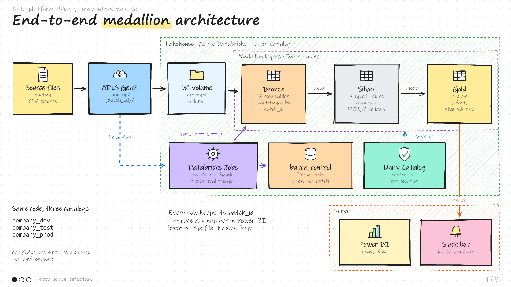
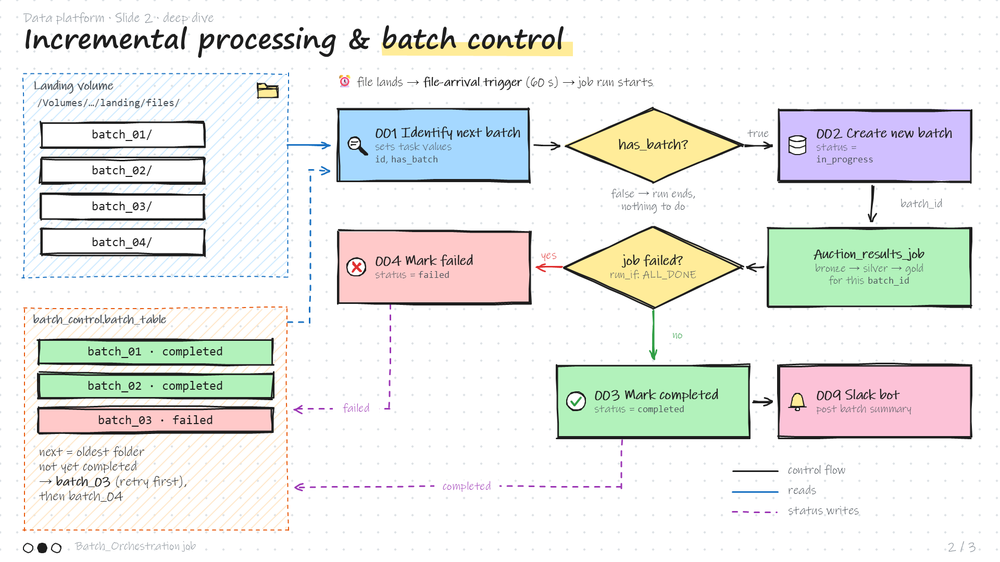
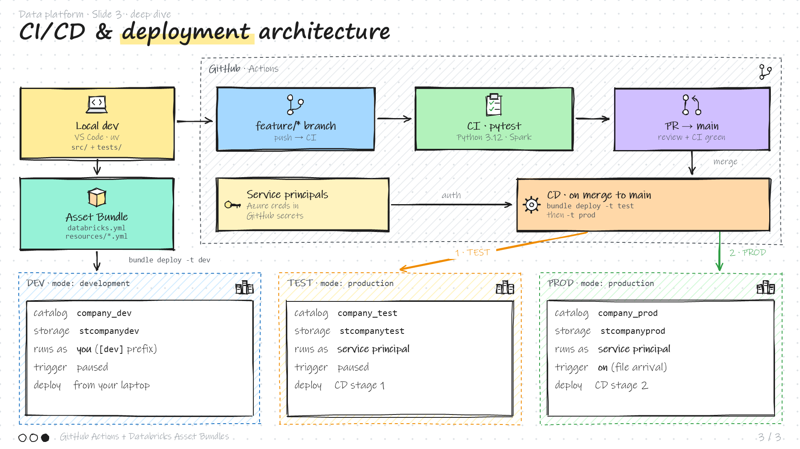

# Azure Databricks Medallion Pipeline

An end-to-end batch data platform on **Azure Databricks**. Raw CSV exports land in ADLS Gen2. A file-arrival trigger picks them up, and a Bronze → Silver → Gold pipeline turns them into a star schema for Power BI. Every batch is tracked in a Delta control table, so failed loads are retried automatically and reruns never duplicate data. The whole project is deployed to DEV, TEST and PROD with **Databricks Asset Bundles** and **GitHub Actions**.



## Tech stack

| Area | Tools |
|---|---|
| Storage | Azure Data Lake Storage Gen2, Delta Lake |
| Compute | Azure Databricks (serverless jobs), PySpark, Spark SQL |
| Governance | Unity Catalog: storage credential, external location, external volume, one catalog per environment |
| Orchestration | Databricks Jobs: file-arrival trigger, task values, condition tasks, `run_if: ALL_DONE` |
| Serving | Power BI on the Gold layer, Slack summary per batch |
| CI/CD | GitHub Actions, pytest, Databricks Asset Bundles, Azure service principals |

## How the data flows

1. **Land.** Source CSVs arrive in ADLS Gen2, one folder per batch: `landing/{batch_id}/`.
2. **Govern.** Unity Catalog exposes the landing area as an external volume (`/Volumes/<catalog>/landing/files`). Notebooks never use storage keys or mounts.
3. **Bronze.** Raw data with **explicit schemas** (no `inferSchema`), partitioned by `batch_id` and written with `replaceWhere`, so re-running a batch replaces only that batch.
4. **Silver.** Typed, cleaned and de-duplicated data, upserted with `MERGE`. The transformation logic lives in `src/transformations` as plain PySpark functions, so it can be unit tested.
5. **Gold.** A star schema with 4 dimensions (auction, users, lots, consignors) and 3 facts (registered users, timed auction, auction results).
6. **Serve.** Power BI reads Gold, and a Slack bot posts a summary when each batch completes.

## Incremental processing and batch control



The `Batch_Orchestration` job ([resources/Batch_Orchestration.yml](resources/Batch_Orchestration.yml)) processes **one batch per run**:

| Task | What it does |
|---|---|
| `000_create_control_table` | Creates `<catalog>.batch_control.batch_table` if it doesn't exist |
| `001_Identify_next_batch` | Lists the landing folders, subtracts batches already `completed`, picks the oldest, and publishes `id` / `has_batch` as task values |
| `is_there_a_batch_to_process` | Condition task that ends the run cleanly when there's nothing new |
| `002_Create_New_Batch` | Records the batch as `in_progress` |
| `auction_results_job` | Runs the Bronze → Silver → Gold child job ([resources/Auction_results_job.yml](resources/Auction_results_job.yml)) for that `batch_id` |
| `did_the_job_fail` | `run_if: ALL_DONE`, so failures are caught instead of stopping the run |
| `004_Failed_Batch` / `003_Complete_Batch` | Marks the batch `failed` or `completed` |
| `009_Slack_Bot` | Posts the batch summary |

A failed batch is never marked `completed`, so **the next run retries it first**. Job queueing is enabled, so triggered runs never overlap.

## CI/CD and environments



- **CI** ([.github/workflows/CI.yml](.github/workflows/CI.yml)) runs `pytest` on every push to `feature/**` and on every pull request into `main`.
- **CD** ([.github/workflows/CD.yml](.github/workflows/CD.yml)) runs on merge to `main`. It deploys the bundle to TEST, then to PROD (`needs: TEST`), authenticating as an Azure service principal.
- **Bundle targets** ([databricks.yml](databricks.yml)):

| Target | Mode | Catalog | Runs as | Trigger |
|---|---|---|---|---|
| `dev` | development | `company_dev` | you, with a `[dev]` prefix | paused |
| `test` | production | `company_test` | service principal | paused |
| `prod` | production | `company_prod` | service principal | **on** |

## Repository layout

```
databricks.yml            Bundle definition and dev / test / prod targets
resources/                Job definitions (orchestration + medallion job)
notebooks/
  setup/                  Unity Catalog objects, environment variables, table comments
  control_table/          Batch control tasks (identify / create / complete / fail)
  bronze/ Silver/ Gold/   Medallion layer notebooks
src/transformations/      Unit-testable PySpark transformation functions
tests/                    pytest suite (Spark session fixture in conftest.py)
.github/workflows/        CI and CD pipelines
```

## Running it yourself

**Prerequisites:** an Azure subscription, a Unity Catalog-enabled Databricks workspace per environment, an ADLS Gen2 account, and the [Databricks CLI](https://docs.databricks.com/dev-tools/cli/install.html).

1. Replace the placeholders in `databricks.yml`: the workspace `host` values, the service principal application IDs, and the `catalog`, `storage_account`, `container` and `notification_email` variables.
2. Run `notebooks/setup/001_Setup` once to create the storage credential, external location, catalogs and schemas.
3. Install dependencies and run the tests:
   ```bash
   uv sync --dev
   uv run pytest
   ```
4. Deploy a development copy and run it:
   ```bash
   databricks bundle deploy --target dev
   databricks bundle run Batch_Orchestration --target dev
   ```
5. For CI/CD, add `AZURE_TENANT_ID`, `AZURE_CLIENT_ID` and `AZURE_CLIENT_SECRET` as secrets on the GitHub `test` and `prod` environments, and set the workspace hosts in `.github/workflows/CD.yml`.

To enable the Slack summary, create a Unity Catalog HTTP connection named `slack_auction_conn` and put your incoming-webhook path in `notebooks/Gold/009_Slack_Bot`.
